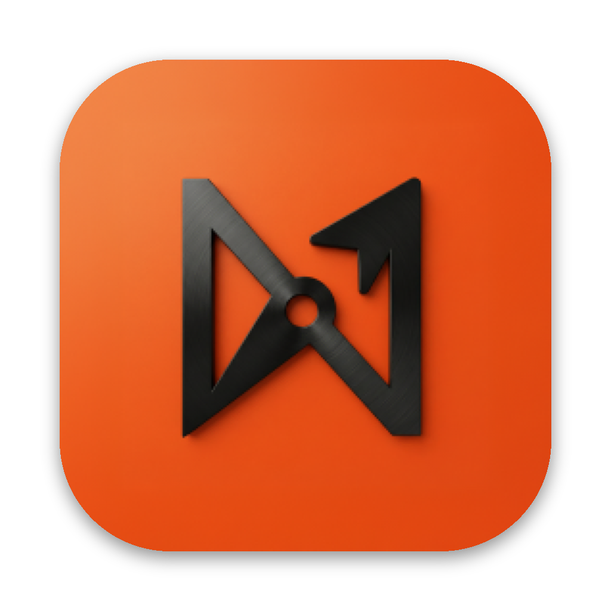

<div align="center">



# Nordus

**O seu time de IA, num app de conversa.**

Robôs que trabalham como funcionários, cada um com o seu modelo, computador, memória e apps,<br>
lado a lado com as pessoas do seu time. Código aberto, no seu computador ou no seu servidor, usando as assinaturas de IA que você já paga.

<a href="https://github.com/Gabriel-Zim/nordus/releases/latest/download/Nordus.dmg"></a>
<a href="https://github.com/Gabriel-Zim/nordus/releases/latest/download/Nordus-intel.dmg"></a>
<a href="https://github.com/Gabriel-Zim/nordus/releases/latest/download/Nordus-setup.exe"></a>
<a href="#2-num-servidor-vps"></a>

[README in English](README.md) · [Guia de instalação completo (em inglês)](INSTALL.md)

</div>

---

## Instale com uma linha

| Onde | Comando |
|---|---|
| **Mac** (o app) | `curl -fsSL https://raw.githubusercontent.com/Gabriel-Zim/nordus/main/install.sh \| bash` |
| **Windows** (o app, no PowerShell) | `irm https://raw.githubusercontent.com/Gabriel-Zim/nordus/main/install.ps1 \| iex` |
| **VPS / servidor Linux** (24 horas, com HTTPS) | `curl -fsSL https://raw.githubusercontent.com/Gabriel-Zim/nordus/main/install.sh \| bash` |

### Ou peça para uma IA instalar

Abra o [Claude Code](https://claude.com/claude-code) (ou o Codex, ou outro agente de programação) e diga:

> Instale o Nordus de https://github.com/Gabriel-Zim/nordus neste computador. Siga o INSTALL.md.

ou, para um servidor:

> Instale o Nordus de https://github.com/Gabriel-Zim/nordus na minha VPS `root@1.2.3.4`. Siga o INSTALL.md.

O agente lê o [INSTALL.md](INSTALL.md), roda os comandos e termina entregando o link que já entra no seu Nordus.

## 1. No seu computador (Mac ou Windows)

1. Baixe pelos botões acima ou rode o comando de uma linha da tabela.
   - **Mac:** o app ainda não é autenticado pela Apple. Na primeira vez, clique com o botão direito no Nordus e
     escolha **Abrir**. Se aparecer "está danificado", rode
     `xattr -dr com.apple.quarantine /Applications/Nordus.app` e abra de novo. O comando de uma linha já faz isso.
   - **Windows:** se aparecer "O Windows protegeu o computador", clique em **Mais informações → Executar assim mesmo**.
2. Instale e entre em pelo menos um motor de IA que você já assina:

   ```sh
   npm install -g @anthropic-ai/claude-code && claude      # Claude Code (plano Pro ou Max, ou chave de API)
   npm install -g @openai/codex && codex login             # Codex (plano do ChatGPT)
   ```

   Sem Node? Baixe em [nodejs.org](https://nodejs.org). O Nordus encontra os motores sozinho.
3. Crie o seu primeiro robô, ou adicione um dos 12 robôs prontos da biblioteca.

Os robôs, as conversas e as configurações ficam em `~/.nordus`, no seu computador.

## 2. Num servidor (VPS)

Com o Nordus num servidor, os robôs trabalham 24 horas, mesmo com o computador desligado, e você entra pelo
navegador, pelo app de Mac ou Windows e pelo celular, com **Entrar com Google**.

**Precisa de:** uma VPS com Ubuntu 22.04 ou 24.04 (ou Debian 12), 2 CPUs e 4 GB de RAM, e acesso root. Serve
qualquer provedor: Hostinger, Contabo, Hetzner, DigitalOcean, AWS Lightsail, Oracle. As portas 80 e 443 precisam
estar abertas no firewall do provedor.

Entre no servidor (`ssh root@IP_DO_SERVIDOR`) e rode:

```sh
curl -fsSL https://raw.githubusercontent.com/Gabriel-Zim/nordus/main/install.sh | bash -s -- --yes
```

- **Sem domínio:** pronto. O endereço fica `https://<ip-do-servidor>.sslip.io`, com certificado de verdade.
- **Com domínio próprio:** aponte um registro **A** (por exemplo `nordus.suaempresa.com.br`) para o IP do servidor e
  acrescente `--domain nordus.suaempresa.com.br` no fim do comando.
- **Só na sua rede privada:** acrescente `--tailscale`.

Em uns dez minutos, o instalador:

1. instala o Node 24, o git e as ferramentas de compilação;
2. cria a conta `nordus`, baixa e compila o Nordus;
3. instala o Claude Code, o Codex e o navegador que os robôs usam;
4. liga o serviço `nordus`, que sobe com o servidor, se recupera sozinho e serve HTTPS;
5. mostra **um link de entrada e um QR code**.

### Depois da instalação

1. **Abra o link de entrada** no navegador (ou leia o QR code com o celular). Ele já entra no seu Nordus. Para outro
   aparelho, rode `nordus pair` no servidor.
2. **Entre nos motores no servidor**, uma vez só:

   ```sh
   sudo -iu nordus claude                      # Claude Code: abra o link que ele mostra e cole o código
   sudo -iu nordus codex login --device-auth   # Codex
   ```

3. **Entrar com Google** (recomendado para times): siga o guia [docs/google-sign-in.md](docs/google-sign-in.md). Em
   cinco minutos no Google Cloud, você e as pessoas que você liberar entram com a conta Google. No Nordus, o lugar é
   **Configurações → Pessoas → Login com Google**, que já mostra o endereço para colar no Google. Para liberar
   alguém: `nordus access add pessoa@gmail.com`.
4. **Celular:** abra o endereço no Safari ou no Chrome e adicione à tela de início. Funciona como app, com avisos.

### Ligar o app de Mac ou Windows ao seu servidor

Rode `nordus pair` no servidor e copie o link. No app, menu **Server → Add Server from Copied Pairing Link…** (o menu
do app ainda está em inglês). O mesmo menu troca entre o seu computador e cada servidor que você adicionou.

### Comandos do dia a dia (no servidor)

```sh
nordus status                    # como o servidor está
nordus pair                      # novo link de entrada para outro aparelho
nordus sessions                  # aparelhos conectados;  nordus sessions revoke ID
nordus access add a@gmail.com    # quem pode entrar com Google
journalctl -u nordus -f          # registro ao vivo
```

**Atualizar:** rode o mesmo comando de instalação de novo. Ele baixa a versão nova, compila e reinicia, sem perder
robôs, conversas nem entradas.

## Bom saber

- **Apps conectados (Gmail, Slack, GitHub, Notion e mais 500)** passam pelo [Composio](https://composio.dev). No
  código aberto, você usa a sua própria chave de projeto do Composio, que é grátis: crie um projeto em composio.dev,
  copie a chave e cole em **Configurações → Chaves de API → Hospedar os apps conectados por conta própria**.
  Servidores MCP próprios não precisam de chave.
- **Endereço público gerenciado e Nordus Cloud** (`nordus login`, `serve --tunnel`, computadores na nuvem vendidos
  no app) são serviços do produto hospedado e não fazem parte do código aberto. Use o instalador de VPS (com o seu
  endereço HTTPS), o Tailscale ou o seu domínio.
- **Instaladores sem assinatura paga:** os apps ainda não são assinados com certificado da Apple e da Microsoft. Os
  comandos de uma linha resolvem os avisos; à mão, veja as notas da seção 1.

## O que o Nordus traz

O Nordus é um fork do [OpenMausBot](https://github.com/milind-soni/OpenMausBot), usado todo dia por uma agência
criativa com dezenas de robôs atendendo clientes de verdade. Em cima da base, ele acrescenta:

- **Decisões com o Jev.** O modelo de decisão escolhe quem responde na sala e quais aprovações podem seguir, dentro de
  limites por tarefa e por dia. No modo Automático, ele compara cada ação com o pedido da pessoa e libera sem cartão
  quando bate. **Ações críticas sempre esperam uma pessoa**: gastar, apagar de vez, enviar para fora, publicar e mudar
  configuração. O líder do time aprova pelos membros, o robô responde na hora com uma frase curta antes do trabalho, e
  "salva como regra" vira regra na hora.
- **Navegador de verdade, que você assiste e assume.** Palco ao vivo no chat com **Ao vivo** e **Assumir controle**,
  miniatura flutuante sempre que um robô navega, janela do Chrome por perfil com os logins guardados, chaveiro que
  empresta sessões sem entregar senha, saída opcional pela internet da sua casa e um piloto que trabalha sozinho até
  o objetivo.
- **Pessoas e robôs na mesma sala.** Salas como num app de mensagens (foto, descrição, mídia, links, documentos,
  favoritas), passagens de trabalho entre robôs, o **Agora** de cada robô, a seção "Precisa de você" e isolamento de
  cliente: o robô de um cliente nunca vê o trabalho interno nem o de outro cliente.
- **Para um time de verdade.** Entrar com Google com lista de espera, avisos com o app fechado (inclusive no iPhone),
  Quadro, Drive e Wiki, robôs de vidro com estados no lugar de mascote, 12 robôs prontos na biblioteca (editor de
  vídeo, tráfego pago, social media, designer de IA, pesquisador, programador e mais), áudio que tenta de novo antes
  de falhar, qualquer arquivo como anexo e um servidor mais rápido.

E tudo o que já vinha da base: um computador para cada robô, memória, rotinas e webhooks, apps conectados e
servidores MCP, voz, servidor MCP para clientes externos e uma linha de comando.

## Contribuir

Forks e pull requests são bem-vindos. Leia o [CONTRIBUTING.md](CONTRIBUTING.md) antes: PRs pequenos e focados, teste
para mudança no servidor, print para mudança de tela. Falha de segurança se reporta em particular, como diz o
[SECURITY.md](SECURITY.md), nunca numa issue pública.

## Licença e créditos

[Licença Apache 2.0](LICENSE). Copyright 2026 ZIM INOVA SIMPLES I.S. e colaboradores do Nordus.

O Nordus nasceu como fork do [OpenMausBot](https://github.com/milind-soni/OpenMausBot), criado por Milind Soni e pelos
colaboradores do OpenMausBot, sob a licença Apache 2.0. Obrigado por construírem isso em aberto. O aviso de atribuição
deles está no [NOTICE](NOTICE), como a licença exige. O Nordus é um projeto independente, sem vínculo com o
OpenMausBot, cujo nome e mascote são marcas do dono.
