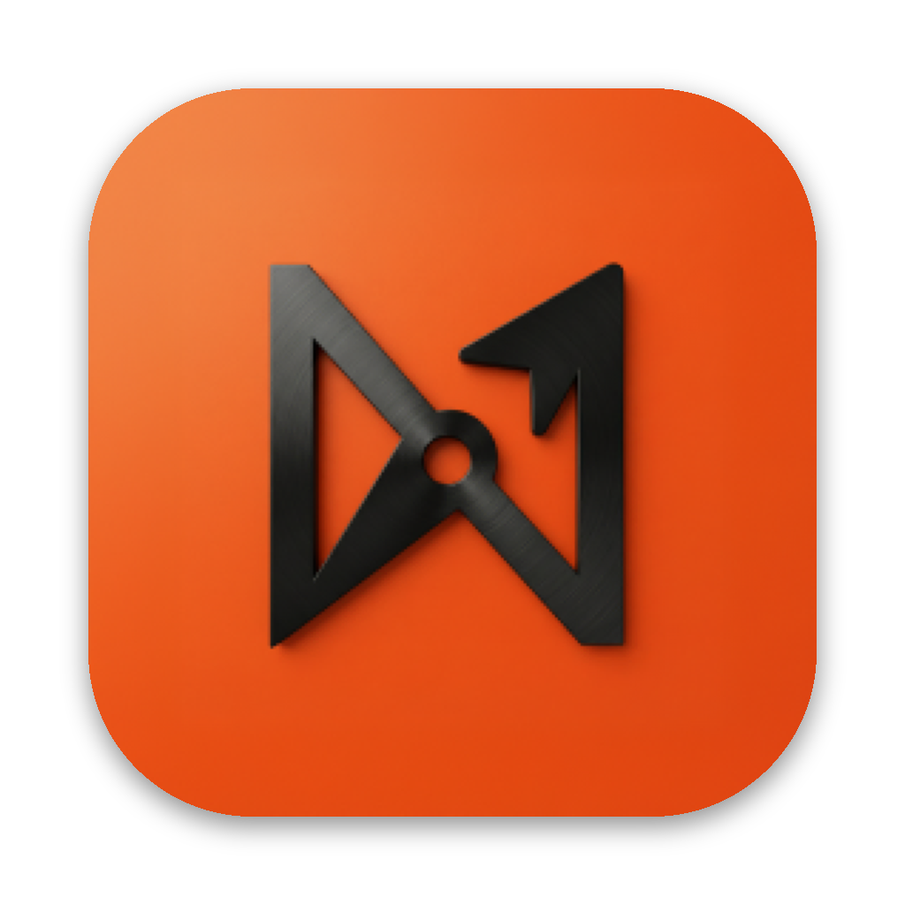

<div align="center">



# Nordus

**Your AI team, in a chat app.**

Bots that work like employees, each with its own model, computer, memory and apps,<br>
side by side with the people on your team. Open source, self-hosted, on the AI subscriptions you already pay for.

[](https://github.com/Gabriel-Zim/nordus/releases/latest)
[](LICENSE)


<a href="https://github.com/Gabriel-Zim/nordus/releases/latest/download/Nordus.dmg"></a>
<a href="https://github.com/Gabriel-Zim/nordus/releases/latest/download/Nordus-intel.dmg"></a>
<a href="https://github.com/Gabriel-Zim/nordus/releases/latest/download/Nordus-setup.exe"></a>
<a href="INSTALL.md#2-a-server-vps"></a>

**[Install guide](INSTALL.md)** · **[Leia em português](LEIA-ME.md)** · [nordus.ai](https://nordus.ai)

</div>

---

## Install in one line

| Where | Command |
|---|---|
| **Mac** (the app) | `curl -fsSL https://raw.githubusercontent.com/Gabriel-Zim/nordus/main/install.sh \| bash` |
| **Windows** (the app, in PowerShell) | `irm https://raw.githubusercontent.com/Gabriel-Zim/nordus/main/install.ps1 \| iex` |
| **VPS / Linux server** (24/7, with HTTPS) | `curl -fsSL https://raw.githubusercontent.com/Gabriel-Zim/nordus/main/install.sh \| bash` |

Prefer clicking? Use the download buttons above. Want an AI to do it? Open [Claude Code](https://claude.com/claude-code),
Codex or any coding agent and say:

> Install Nordus from https://github.com/Gabriel-Zim/nordus on this computer (or: on my VPS at `root@1.2.3.4`). Follow INSTALL.md.

The agent reads [INSTALL.md](INSTALL.md), which is written for both people and agents, and finishes with your Nordus
open and signed in.

## What it is

Nordus is a workspace where AI agents work as members of your team. Every bot in the sidebar is a real agent running
on an engine you already use (Claude Code, Codex, Grok, Gemini, Kimi, or any ACP or OpenAI-compatible endpoint), with
its own personality, model, computer and connected apps. People and bots share rooms, hand work to each other and
follow it live. Anything that matters waits for a person to say yes.

It runs where you choose: as a desktop app on your Mac or PC, or as a server on a VPS that keeps working while every
laptop is closed, reachable from the browser, the desktop apps and your phone, with **Sign in with Google**.

## What Nordus adds

Nordus is a fork of [OpenMausBot](https://github.com/milind-soni/OpenMausBot) (see [Credits](#credits)), built and run
every day by a creative agency with dozens of bots serving real clients. Everything below came out of that work.

**Decisions with Jev, so bots ask less and never risk more.**
- The fast decision model ([Jev](docs/decision-model.md), or OpenRouter and Cloudflare [CLEF](docs/nordus-clef.md))
  decides who answers in a room and which approvals can go ahead, inside limits per task and per day.
- In Automatic mode, Jev compares each action with what the person asked: if it matches, it is approved once, without a
  card; if it is in doubt, the card comes back.
- **Critical actions always wait for a person**, even with full access: spending money, deleting for good, sending
  something outside, publishing, and changing configuration.
- Team leaders approve on behalf of their members, with the person only seeing what is really theirs to decide.
- Instant replies: a request that needs work gets a short, natural acknowledgment from the bot right away, then the
  result.
- "Save as a rule": a lesson the person asks to keep becomes a rule on the spot.

**A browser the bots really use, that you can watch and take over.**
- A live stage in the chat shows the bot's browser with **Live** and **Take control**; control follows the tab Chrome
  shows, and a floating live thumbnail appears whenever a bot is browsing.
- A native Chrome window per profile with its own display, logins kept between runs, and sign-in cards that open where
  you are.
- A keychain lends signed-in sessions to bots without giving them passwords, with optional traffic through your own
  internet connection.
- A browser pilot that works toward a goal on its own and never wastes its budget on pages that never settle.

**People and bots in the same room.**
- Rooms like a messenger: room photo or mosaic, description with links, media, links and documents tabs, favorites,
  members with labels, and a clean central pill with the members.
- Handoffs between bots, the bot's profile with **Now** (current task, how long, where it came from, Stop and the
  queue), and a "needs you" section for what waits on a person.
- Client isolation: a client's bot never sees internal work or another client's, and an exit gate checks outbound
  messages for leaks.
- Guests, invite links approved by the owner, and visibility by audience.

**Built for a real team.**
- **Sign in with Google** with a waiting list for new people, run by your own server ([guide](docs/google-sign-in.md)).
- Web Push notifications with the app closed, including iPhone home screen apps, quiet hours and digests.
- A Board, Drive and Wiki for the team's files and knowledge ([board](docs/board.md), [drive and wiki](docs/drive-wiki.md)).
- Glass robot avatars with states (working, thinking, waiting) instead of a mascot.
- 12 ready-made bot templates (video editor, paid traffic, social media, AI designer, researcher, programmer and more)
  in the in-app library, each with skills and a "before you use" checklist ([nordus-teams](https://github.com/Gabriel-Zim/nordus-teams)).
- Voice notes that retry instead of failing, any file as an attachment with live upload progress, and a mobile layout
  that behaves like a native iOS app.
- A faster server: tuned SQLite, bounded caches, lazy first screen, and recovery that explains in plain words what
  happened.
- Portuguese and English first, with a clean interface and no technical noise in the chat.

**Everything from the base project**: a computer for every bot (isolated VM, your own VPS, or your own computer after
explicit opt-in), long-term memory, routines and webhooks, connected apps and custom MCP servers, voice, an MCP server
for external clients and a headless CLI.

## How it works

Two processes. The app sends typed commands over HTTP and folds a single Server-Sent Events stream into its state. The
harness server owns every agent process and turns each engine's native protocol into one runtime event stream, logged
per thread.

| Layer | Where | What it does |
|---|---|---|
| Drivers | `server/drivers/` | One per engine, over its local CLI or ACP. Adding an engine is one file plus one registration line. |
| Harness | `server/harness/` | The registry of live bots and the event bus every client reads. |
| API | `server/index.ts` | Bots, turns, approvals, models, computers, connectors and settings, over HTTP and SSE. |
| App | `src/` | The chat interface (React). |
| Desktop | `electron/` | macOS, Windows and Ubuntu shells with the server built in. |

Bots, settings and conversations live in `~/.nordus` on the machine that runs the server.

## Develop

Requirements: Node 24 or newer, pnpm 10, and at least one agent CLI installed and signed in:
[Claude Code](https://claude.com/claude-code), [Codex](https://github.com/openai/codex) or [Grok](https://x.ai/cli).

```sh
git clone https://github.com/Gabriel-Zim/nordus.git nordus && cd nordus
pnpm install

pnpm dev:server    # harness server on 127.0.0.1:8799
pnpm dev           # app on http://127.0.0.1:5199
pnpm dev:desktop   # desktop shell; keep the two commands above running

pnpm typecheck && pnpm test
```

Package the desktop app with `pnpm package:mac`, `pnpm package:win` or `pnpm package:linux`. The
[Installers workflow](.github/workflows/installers.yml) builds all three on GitHub and publishes the release.

More: [self-hosting reference](docs/self-hosting.md) · [VPS guide](docs/deploy-vps.md) ·
[headless CLI](docs/headless-cli.md) · [MCP server](docs/mcp-server.md) · [custom engines](docs/custom-engines.md) ·
[custom MCP servers](docs/custom-mcp-servers.md).

## Contributing

Forks and pull requests are welcome. Read [CONTRIBUTING.md](CONTRIBUTING.md) first: small, focused PRs, tests for
server changes, screenshots for UI changes. Report vulnerabilities privately as described in [SECURITY.md](SECURITY.md),
never in a public issue.

## License

[Apache License 2.0](LICENSE). Copyright 2026 ZIM INOVA SIMPLES I.S. and Nordus contributors. Third-party components keep their
own licenses, listed in [NOTICE](NOTICE) and [`third_party/`](third_party/).

## Credits

Nordus is a fork of [OpenMausBot](https://github.com/milind-soni/OpenMausBot), created by Milind Soni and the
OpenMausBot contributors and released under the Apache License 2.0. The chat-app shape, the harness, the drivers and
much more come from that project: thank you for building it in the open. Its attribution notice is kept in
[NOTICE](NOTICE), as the license requires.

Nordus is an independent project, not affiliated with or endorsed by OpenMausBot, whose names and mascot are
trademarks of their owner. Claude, Codex, Grok, Gemini and Kimi are trademarks of their respective owners.
